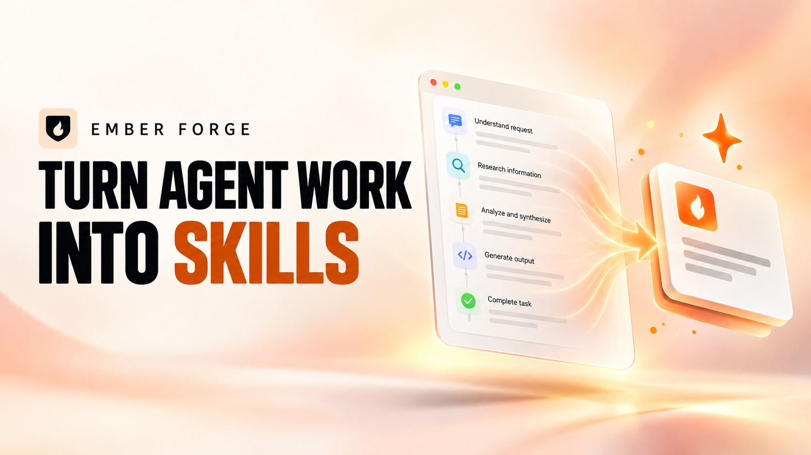
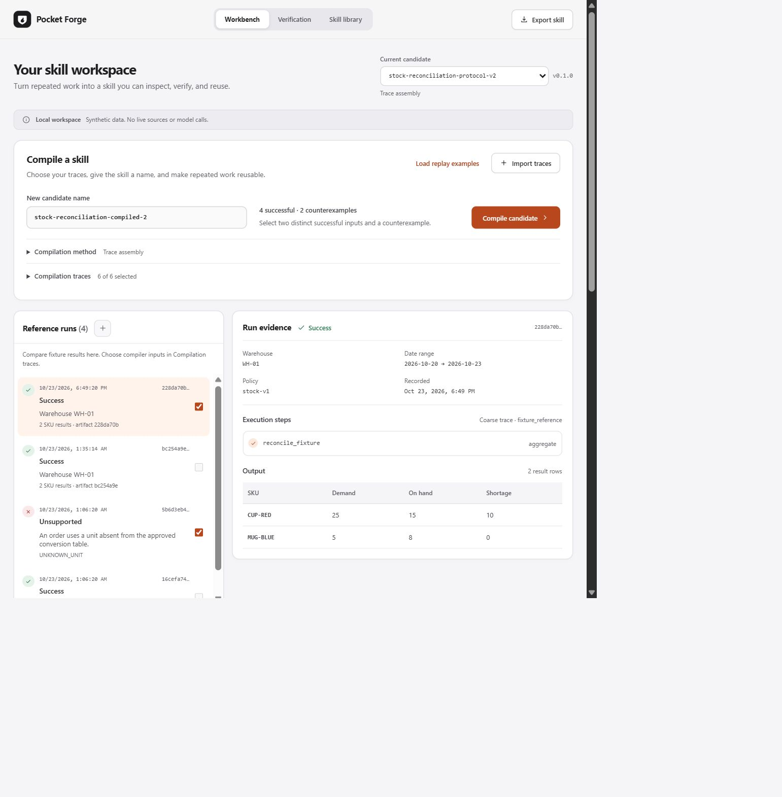
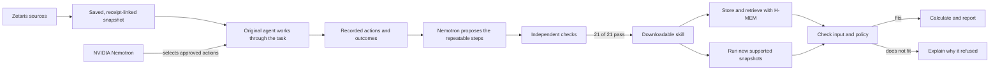

<p align="center">
  
</p>

<h1 align="center">Ember Forge</h1>

<p align="center"><strong>Turn repeated work into reusable skills.</strong></p>

<p align="center">
  <a href="#try-the-included-skill">Try the demo</a> ·
  <a href="docs/product-story.md">Product story</a> ·
  <a href="docs/sponsor-integration-review.md">Sponsor integrations</a> ·
  <a href="docs/run-and-evidence.md">Run and evidence</a>
</p>

<p align="center">
  
</p>

<p align="center"><em>Product launch artwork · reusable skills built from recorded agent work</em></p>

An operations team may repeat the same reconciliation every day: read new orders, match supplier names to products, convert units, compare demand with stock, and flag shortages. The records change; the steps do not.

**Ember Forge turns that repeated agent work into a checked, downloadable skill.** It records how an agent handled examples, asks NVIDIA Nemotron to propose a reusable procedure, checks the result against an independent reference, and packages the passing procedure with its accepted inputs, runner, examples, and evidence.

> **Current evidence:** the Zetaris-origin stock skill passed 21/21 development checks (7 supported inputs, 14 explicit refusals). Its included snapshot runs offline without Zetaris or a model call. H-MEM is used in the working Skill Library. All business records are synthetic; broad workflow learning and real-warehouse accuracy remain unproven.

For the plain-language explanation, start with the [product story](docs/product-story.md). The [sponsor integration review](docs/sponsor-integration-review.md) shows what Zetaris, Nemotron, and H-MEM did in the build, including the failures and limits. The [run guide and evidence index](docs/run-and-evidence.md) links directly to the inputs, outputs, receipts, and tests.

<details>
<summary><strong>Preview the workbench</strong> — historical capture of the amber-red interface</summary>

<p align="center">
  
</p>

Actual local UI capture from 24 October 2026 using synthetic data, before the Ember Forge rename. It illustrates the interface; it is not a fresh verification of later backend changes. See the [interface notes](docs/design/apple-interface.md) and [brand assets](docs/design/brand.md).

</details>

## From live data to a reusable skill



The live Zetaris read happens when the snapshot is created. A portable execution uses that snapshot; it does not need a live database, a model endpoint, or a running Ember Forge server.

## Who benefits

- Operations and inventory planners who repeat the same checks over new records.
- Data teams that need to trace where a result came from and which rules were applied.
- Agent builders who want a portable procedure that says what it accepts and when it should stop.

## How it differs

| Approach | What it saves | Ember Forge's addition |
| --- | --- | --- |
| Re-ask an agent | Flexible reasoning | A tested procedure for cases already shown to fit |
| Save a prompt or instructions | Guidance for another model call | A runnable skill with an input contract, checks, and evidence |
| Cache an answer | The same prior result | Recalculate from changed input records |
| Write a one-off script | A fixed implementation | Recorded examples, explicit boundaries, and traceable verification |

Ember Forge still uses Nemotron to investigate and propose the procedure. The supported exported procedure itself runs without model reasoning. A host may still spend model tokens selecting the skill; that is separate from executing its steps.

## What the evidence says about impact

In a separate frozen synthetic comparison, the exact executable passed 27/27 repeated invocations with zero model requests. The instruction-only version passed the same 27 invocations with 33 model requests; the original agent passed 24/27. The 27 invocations were three repeats of nine cases, not 27 independent tasks. The comparison excludes the full cost of compilation and does not establish dollars saved or real-world performance. See the [full results and limits](docs/live-verification.md).

## Try the included skill

With Node.js 24 installed, run the supported example and the explicit refusal:

```sh
node demo-kit/zetaris/verify.mjs
```

It checks the stock result and confirms that an unapproved unit is refused with `UNKNOWN_UNIT`. Both checks use tracked JSON snapshots and make zero model or Zetaris calls. See [the run guide](docs/run-and-evidence.md) for the expected result and evidence links.

## Run the application

### Requirements

| Tool | Version |
| --- | --- |
| Node.js | `24.13.0` or newer within Node 24 (`<25`) |
| pnpm | `11.25.0` |
| Git | Required to clone the repository |

```sh
git clone https://github.com/SS-360/ember-forge.git
cd ember-forge
pnpm install --frozen-lockfile
pnpm doctor
pnpm dev
```

With the required Node/pnpm versions already installed, `pnpm setup:local` performs the locked dependency install and starts the app in one command. This new convenience command still needs a fresh-clone rehearsal.

Open **[http://127.0.0.1:5174](http://127.0.0.1:5174)**. The Fastify API listens on `127.0.0.1:3001`; Vite proxies `/api` requests to it.

**No provider keys are required for the synthetic local workflow.** Dependency installation needs registry access or a populated pnpm cache. Starting the app does not automatically run tests or package checks.

## Your first skill

1. **Load examples.** In **Workbench → Compile a skill**, choose **Load replay examples**. These are synthetic traces recorded from the supplied interpreter.
2. **Choose evidence.** Select at least two successful traces with distinct input hashes and one counterexample. Custom imports must follow the [sanitized trace format](docs/trace-compilation.md).
3. **Compile a candidate.** Use an unused name such as `stock-reconciliation-demo`. Keep **Trace assembly** selected. Compilation runs development verification and prepares an export when checks pass.
4. **Review and download.** Open **Verification** to inspect supported cases, explicit rejections, the contract, and package contents. Optionally choose **Freeze and evaluate** to retain a separate synthetic evaluation result.
5. **Reuse it.** Download the Agent Skill, or open **Skill library → Register current candidate**. Load synthetic input, edit compatible data, then choose **Retrieve and execute**.

Candidate names preserve separate artifacts. The header selector reopens saved candidates. Policy or schema drift can deprecate an incompatible library entry; this path has no automatic model fallback.

For the live-source workflow, see the [Zetaris-to-skill demo](docs/zetaris-demo.md). The live read runs through the local Zetaris stack, then saves a receipt-bound snapshot for agent runs and skill compilation. No AWS cluster or 24/7 public endpoint is needed. Judges can run the exported skill offline with the tracked source snapshot in [`demo-kit/zetaris/`](demo-kit/zetaris/).

## Meterless Engine: H-MEM working feature

Ember Forge uses the pinned Meterless H-MEM reference in its actual **Skill Library** feature. Registration accepts only an independently verified candidate and stores its evidence references in H-MEM. Retrieval nominates a candidate; Ember Forge then checks artifact hashes and input applicability before its bounded runtime executes it. A schema or policy mismatch rejects and deprecates the stale entry. This path makes zero model calls.

Reproduce the product integration proof from the repository root:

```sh
pnpm exec vitest run packages/memory/test/skill-memory.test.ts
pnpm hmem:conformance
pnpm memory:demo
```

The product-level suite exercises generated-name retrieval, registration and retrieval across a service restart, bounded execution, schema/policy invalidation, and refusal of unverified or altered candidates. On 27 October 2026, it passed **7/7 tests**; the pinned H-MEM conformance suite passed **13/13 checks**. The demo returned `stock-reconciliation@0.1.0` from warm H-MEM retrieval, executed it, then refused a changed inventory schema with `SCHEMA_VERSION_MISMATCH` and marked the stale entry deprecated. Each demo writes a detailed run record under ignored `artifacts/memory-demo/`.

For a UI demonstration, start `pnpm dev`, open the **Skill library** view, register the current passing candidate, load the synthetic input, and choose **Retrieve and execute**. The evidence panel shows the accepted memory ID, bounded execution, and zero model calls. Change `dataset.sourceSchemaVersions.inventory` to `inventory/v2` and run again to show the stale-schema refusal. This H-MEM check uses synthetic data; the separate [Zetaris-to-skill demo](docs/zetaris-demo.md) covers live local reads and the agent path.

For the **model-generated workflow**, import a sanitized work sample, observe original agent runs, and inspect their recorded tool steps and shortage reports. Collect two distinct successful inputs and a counterexample, select only their original-agent traces, and choose **Nemotron synthesis** in Compilation method. This path requires a configured free endpoint and local authorization; replay examples stay separately labeled. The first successful live synthesis used 13,543 input and 1,122 output tokens, after earlier failed attempts; whole-workflow usage is partially unknown and retained in the local ledger.

## What you download

An Agent Skill folder contains both host instructions and the executable procedure:

```text
<skill-name>/
├── SKILL.md                       # Agent-facing instructions and metadata
├── skill.json                     # Bounded operations and parameters
├── contract.json                  # Supported inputs and assumptions
├── runtime/
│   └── emberforge-runtime.mjs     # Bundled standalone Node.js runner
├── tests/
│   ├── cases.json                 # Finite development cases
│   ├── verify-export.mjs          # Package execution checks
│   └── network-guard.mjs          # Node networking instrumentation
├── examples/
│   └── unsupported-unknown-unit.json
├── input.example.json
├── bindings.example.json
├── verification.json              # Development results and limitations
├── provenance.json                # Artifact hashes and completion receipt
├── lineage.json                   # Included when trace lineage is available
├── package.json
├── THIRD_PARTY_NOTICES.md
└── README.md
```

### Run an exported skill

Extract the download and enter its directory. Copy `input.example.json` to `input.json`, then replace the parameters and dataset with data matching `contract.json`.

```sh
node runtime/emberforge-runtime.mjs --input input.json --output result.json
```

The bundle requires Node 24, with no separate dependency installation or running Ember Forge server. Input and output paths resolve from your current directory; bundled assets resolve from the installed skill directory. The current runner consumes JSON rather than querying live business systems.

Unsupported inputs return structured reasons such as `UNKNOWN_UNIT`, `POLICY_VERSION_MISMATCH`, or `SCHEMA_VERSION_MISMATCH`. Downloads require a successful package-check receipt bound to the candidate and verification hashes. Older exports without that receipt need an explicit re-export.

### Where can the skill be used?

| Environment | Use | Current evidence |
| --- | --- | --- |
| Ember Forge | Retrieve and execute a registered skill on new compatible inputs | New Nemotron candidate retrieved/executed in isolated H-MEM; schema drift rejected |
| Standalone Node.js | Run the exported procedure from a terminal or another application | New candidate passed exact-package execution checks; frozen-input comparison recorded separately |
| Codex | Install the Agent Skill folder in a host-supported skill location | Explicit supported and unsupported runs of `stock-nemotron-be33034d-retry-2`; automatic selection not verified |
| Claude Code | Use the exported instructions and bundled runner | Explicit supported and unsupported runs of the same earlier export; automatic selection not verified |
| Hermes Agent CLI | Automatically select and run the bundled procedure | Selected `zetaris-stock-207ca2ab-retry-3` without naming it; one supported synthetic run passed |
| OpenClaw | Install the Agent Skill folder in its active workspace | Automatically selected the same newer export; supported run passed and unsupported unit returned `UNKNOWN_UNIT`. Host wrapper changed the runner exit code from 2 to 1 |

The export is an **Agent Skill folder**. Codex plugin bundles and Claude marketplace packages require additional host-specific packaging. A host may still use model tokens to select and invoke a skill; the supported procedure itself runs without a model call. See the [compatibility matrix](docs/skill-compatibility.md) for the exact evidence boundaries and [marketplace packaging](docs/marketplace.md) for offline ClawHub staging and its license gate.

## How it works

Nemotron works through an original task using approved actions such as reading a source, filtering rows, joining tables, or refusing unsupported data. Ember Forge records the actions and outcomes. For skill creation, Nemotron proposes a typed procedure; independent checks decide whether it can be exported. The trusted runner executes only declared operations, and H-MEM helps the local Skill Library find a verified candidate. Read [the full workflow and agent design](docs/how-it-works.md).

## Technology

| Layer | Technology | Responsibility |
| --- | --- | --- |
| Interface | React 19, TypeScript, Vite 8 | Compilation workbench, verification, export, and Skill Library |
| API | Node.js 24, TypeScript, Fastify 5 | Local APIs, orchestration, job lifecycle, and exports |
| Validation | Zod 4 | Input, trace, candidate, contract, and authorization schemas |
| Execution | Bounded JSON instructions + TypeScript interpreter | Deterministic execution within declared limits |
| Storage | Built-in Node SQLite + artifact files | Run history, job checkpoints, provider ledger, and versioned artifacts |
| Memory | Meterless H-MEM reference integrated in the Skill Library | Store, retrieve, and invalidate verified skills locally |
| Reasoning | NVIDIA Nemotron adapter | Original agent decisions and bounded skill proposals; disabled by default in fresh clones |
| Data integration | Zetaris JDBC + local PostgreSQL sources | Two registered stock databases, live table reads, freshness check and cross-source reconciliation join verified on synthetic data |
| Verification tooling | Vitest, independent evaluator, esbuild | Unit suites, reference comparisons, and portable runtime bundling |

## Repository map

```text
apps/
  web/                  React interface and brand assets
  api/                  Fastify routes, SQLite, jobs, and integrations
packages/
  contracts/            Shared Zod schemas
  compiler/             Assembly, verification, replay, synthesis controller
  runtime/              Bounded interpreter and export CLI
  evaluator/            Independent stock-reconciliation reference
  memory/               Verified registry and H-MEM adapter
skills/                 Supplied stock-reconciliation seed
fixtures/               Synthetic development data
evaluation/             Historical frozen evaluation fixtures
scripts/                Development, evaluation, and export commands
config/                 Disabled provider-authorization example
vendor/meterless/hmem/  Pinned upstream reference and attribution
docs/                   Product, architecture, design, and evidence
artifacts/              Generated local state; ignored by Git
```

## Development and verification

Run the checks appropriate to your change:

| Command | Purpose |
| --- | --- |
| `pnpm doctor` | Inspect runtime and configuration readiness without exposing keys |
| `pnpm typecheck` | Static TypeScript checking |
| `pnpm test` | Vitest suite |
| `pnpm eval` | Synthetic reference baseline |
| `pnpm eval:skill` | Supplied seed-skill evaluation |
| `pnpm eval:export` | Build and check the supplied skill in an isolated temporary directory |
| `pnpm memory:demo` | Local memory demonstration |
| `pnpm hmem:conformance` | Vendored H-MEM conformance suite |
| `node demo-kit/zetaris/verify.mjs` | Verify the exported skill against the Zetaris-origin supported and unsupported snapshots, offline |
| `pnpm source:state` | Record a source-content manifest without tests or provider calls |

To export a specific saved candidate, use `pnpm eval:export --candidate artifacts/candidates/<skill-name>`. Export checks instrument common Node networking APIs; they are not an operating-system network sandbox. The [compatibility guide](docs/skill-compatibility.md) covers host-discovery checks separately.

**Latest implementation evidence:** the full suite passes 85 tests across 19 files; TypeScript checking and the Vite production build also pass. The package verifier passes for the OpenClaw-tested export. See [release readiness](docs/release-readiness.md) for scope and limits.

## Provider configuration and local data

The server enforces a **$0 NVIDIA spending ceiling**. The configured free prototyping endpoint has been used for original stock-agent runs and skill synthesis on synthetic data; authorization remains local and fresh clones default to providers disabled. The latest automated suite, TypeScript check, and frontend build pass. The Zetaris-origin workflow is verified through receipt-bound snapshots into agent runs and a validated candidate. The exported skill consumes that snapshot; it does not issue live Zetaris queries during execution. H-MEM is implemented and demonstrated as the Meterless Engine. The app connects to Nemotron directly, which the public Academy FAQ permits; that FAQ also says any cloud is allowed. Nightshift is recommended in the supplied solutioning guide, but is not a blocker under the available public requirements. No AWS cluster or 24/7 public service is needed for this local demo and offline skill evaluation. See the [hackathon resource audit](docs/hackathon-resource-audit.md).

For a fresh checkout, start with `.env.example` and the disabled `config/provider-authorization.example.json`. Credentials alone do not enable calls: server-owned authorization binds the endpoint, model, account, evidence, expiry, and finite quotas. Follow [provider authorization](docs/provider-authorization.md) before activation. The verified local Zetaris JDBC setup is documented in [credentials](docs/credentials.md); live SaaS/tenant transport is unverified.

Run records, local snapshots, candidates, exports, and SQLite databases are stored under ignored `artifacts/`. Approval records belong under ignored `.local/`; credentials belong in ignored `.env`. Compiler inputs exclude raw rows and provider logs, but the trace schema cannot detect every secret concealed in an allowed identifier. Review imported traces before sharing them.

The [compatibility guide](docs/skill-compatibility.md#existing-package-identities) explains how older packages retain their original identities while new artifacts use Ember Forge names.

## Roadmap

- Consider Meterless Nightshift routing only if the full hub rules or sponsor strategy call for it; H-MEM already satisfies the Meterless Engine requirement, and the public Academy FAQ permits direct Nemotron.
- Add direct Zetaris queries to the skill runtime only if live-at-execution behavior is needed; the current supported path captures a verified source snapshot, then runs the portable skill offline.
- Finish HackOS eligibility/team checks, required resource review, sponsor explanation, demo assets, and submission package before the published deadline.
- Broaden host-selection checks, reproduce from a clean checkout, and close remaining authorization/recovery gaps.
- Measure generalization, compilation overhead, and costs against fair live baselines before making savings claims.

The [fulfilment workflow](docs/fulfilment-workflow.md) describes the second domain and its package. The [capability report](docs/release-readiness.md) records current limits; the [claims ledger](docs/claims.md) connects claims to evidence.

## Documentation

| Guide | Start here when you want to… |
| --- | --- |
| [Product story](docs/product-story.md) | Understand the problem, audience, benefit, and difference |
| [How it works](docs/how-it-works.md) | Follow the agent, skill-creation flow, and actual technology stack |
| [Sponsor integration review](docs/sponsor-integration-review.md) | See what we connected, what was difficult, and what we learned |
| [Run and evidence guide](docs/run-and-evidence.md) | Reproduce the included skill, run the local app, and inspect proof |
| [Architecture](docs/architecture.md) | Inspect packages, data flow, and safety boundaries |
| [Fulfilment workflow](docs/fulfilment-workflow.md) | Inspect the second bounded workflow and portable package |
| [Trace compilation](docs/trace-compilation.md) | Import traces, replay snapshots, or inspect API routes |
| [Skill compatibility](docs/skill-compatibility.md) | Understand exports and host verification status |
| [Provider authorization](docs/provider-authorization.md) | Configure bounded provider access |
| [Release readiness](docs/release-readiness.md) | Assess current capabilities and unresolved gates |
| [Hackathon resource audit](docs/hackathon-resource-audit.md) | Review the checked hub requirements, current evidence, and sponsor gaps |
| [Runnable demo kit](demo-kit/README.md) | Run the included verified skill and inspect sanitized agent activity |

## Attribution and licensing

The local memory integration uses the pinned [Meterless H-MEM reference](vendor/meterless/hmem/README.md), whose [Apache 2.0 license](vendor/meterless/hmem/LICENSE) is retained. Exported bundles include their own third-party notices. Ember Forge's pocket-and-flame SVG mark is included in [the web assets](apps/web/public).

No top-level license has been added for Ember Forge's own source. Third-party components retain their respective licenses.
