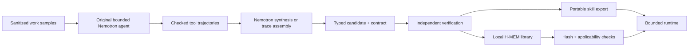

<p align="center">
  
</p>

<h1 align="center">Ember Forge</h1>

<p align="center"><strong>Turn repeated work into reusable skills.</strong></p>

<p align="center">
  <a href="#quick-start">Quick start</a> ·
  <a href="#your-first-skill">First skill</a> ·
  <a href="#what-you-download">The export</a> ·
  <a href="#technology">Tech stack</a> ·
  <a href="#documentation">Documentation</a>
</p>

Ember Forge is a local web application for turning recorded workflows into portable, executable Agent Skills. Collect examples, compile a bounded procedure, inspect its supported inputs and verification evidence, then download it or reuse it through the local Skill Library.

The main compiled domain is **stock reconciliation**: reconcile open orders against inventory using product aliases and unit-conversion rules, then report demand, stock, and shortages. A second, independently versioned **fulfilment exceptions** workflow checks incomplete shipments and overdue orders from a separate schema. It is a configured template today, not a second Nemotron-learned skill.

> **Status: working local prototype.** Genuine Nemotron tool runs have produced a synthesized stock skill, which passed 21 finite development checks and standalone export checks on synthetic data. Codex and Claude Code explicitly executed an earlier export. Hermes and OpenClaw automatically selected and executed the same newer export on one supported synthetic input each. Local Zetaris stock reads and a cross-source join pass on synthetic data. Fresh clones keep provider execution disabled until local authorization is configured. General workflow learning, real warehouse accuracy, production readiness, and cost savings remain unverified.

The workbench supports sanitized JSON/CSV samples, saved original-agent runs, trace assembly, Nemotron synthesis, local H-MEM reuse, and downloadable Agent Skills. In the first frozen four-arm comparison, the exact export passed all 27 invocations with zero model calls; instruction-only also passed all 27 using 33 model requests, while the original agent passed 24/27. These are three repeats of nine synthetic inputs. See the [host and live-source checks](docs/host-and-zetaris-verification.md), [compiler verification record](docs/live-verification.md), [agent workflow](docs/agent-workflow.md), [credential guide](docs/credentials.md), [comparison protocol](docs/comparison-protocol.md), [hackathon resource audit](docs/hackathon-resource-audit.md), and [remaining activation steps](USER_ACTIONS.md).

<details>
<summary><strong>Preview the workbench</strong> — historical capture of the amber-red interface</summary>

<p align="center">
  
</p>

Actual local UI capture from 24 October 2026 using synthetic data, before the Ember Forge rename. It illustrates the interface; it is not a fresh verification of later backend changes. See the [interface notes](docs/design/apple-interface.md) and [brand assets](docs/design/brand.md).

</details>

## Why Ember Forge?

A recurring task often repeats the same reads, filters, lookups, calculations, and checks. Ember Forge makes that procedure explicit and packages it with the conditions under which it can run. For supported JSON inputs, the exported runner executes without Ember Forge or a model API call. Unsupported inputs return a structured reason.

- **Inspect the procedure.** Review bounded operations, parameters, branches, and source-trace lineage.
- **Keep counterexamples.** Record failures alongside successful runs to make boundaries visible.
- **Verify before exporting.** Compare results with an independent reference on finite development cases.
- **Preserve evaluation history.** Freeze a separate synthetic split and retain the first result for a candidate hash.
- **Reuse from memory.** Register verified candidates in local H-MEM, then check hashes and applicability before execution.
- **Take the skill with you.** Export instructions, a bundled Node.js runner, contracts, examples, and evidence together.

## Quick start

### Requirements

| Tool | Version |
| --- | --- |
| Node.js | `24.13.0` or newer within Node 24 (`<25`) |
| pnpm | `11.25.0` |
| Git | Required to clone the repository |

```sh
git clone https://github.com/SS-360/ember-forge.git
cd ember-forge
pnpm install --frozen-lockfile
pnpm doctor
pnpm dev
```

With the required Node/pnpm versions already installed, `pnpm setup:local` performs the locked dependency install and starts the app in one command. This new convenience command still needs a fresh-clone rehearsal.

Open **[http://127.0.0.1:5174](http://127.0.0.1:5174)**. The Fastify API listens on `127.0.0.1:3001`; Vite proxies `/api` requests to it.

**No provider keys are required for the synthetic local workflow.** Dependency installation needs registry access or a populated pnpm cache. Starting the app does not automatically run tests or package checks.

## Your first skill

1. **Load examples.** In **Workbench → Compile a skill**, choose **Load replay examples**. These are synthetic traces recorded from the supplied interpreter.
2. **Choose evidence.** Select at least two successful traces with distinct input hashes and one counterexample. Custom imports must follow the [sanitized trace format](docs/trace-compilation.md).
3. **Compile a candidate.** Use an unused name such as `stock-reconciliation-demo`. Keep **Trace assembly** selected. Compilation runs development verification and prepares an export when checks pass.
4. **Review and download.** Open **Verification** to inspect supported cases, explicit rejections, the contract, and package contents. Optionally choose **Freeze and evaluate** to retain a separate synthetic evaluation result.
5. **Reuse it.** Download the Agent Skill, or open **Skill library → Register current candidate**. Load synthetic input, edit compatible data, then choose **Retrieve and execute**.

Candidate names preserve separate artifacts. The header selector reopens saved candidates. Policy or schema drift can deprecate an incompatible library entry; this path has no automatic model fallback.

## Meterless Engine: H-MEM working feature

Ember Forge uses the pinned Meterless H-MEM reference in its actual **Skill Library** feature. Registration accepts only an independently verified candidate and stores its evidence references in H-MEM. Retrieval nominates a candidate; Ember Forge then checks artifact hashes and input applicability before its bounded runtime executes it. A schema or policy mismatch rejects and deprecates the stale entry. This path makes zero model calls.

Reproduce the product integration proof from the repository root:

```sh
pnpm exec vitest run packages/memory/test/skill-memory.test.ts
pnpm hmem:conformance
pnpm memory:demo
```

The product-level suite exercises generated-name retrieval, registration and retrieval across a service restart, bounded execution, schema/policy invalidation, and refusal of unverified or altered candidates. On 27 October 2026, it passed **7/7 tests**; the pinned H-MEM conformance suite passed **13/13 checks**. The demo returned `stock-reconciliation@0.1.0` from warm H-MEM retrieval, executed it, then refused a changed inventory schema with `SCHEMA_VERSION_MISMATCH` and marked the stale entry deprecated. Each demo writes a detailed run record under ignored `artifacts/memory-demo/`.

For a UI demonstration, start `pnpm dev`, open the **Skill library** view, register the current passing candidate, load the synthetic input, and choose **Retrieve and execute**. The evidence panel shows the accepted memory ID, bounded execution, and zero model calls. Change `dataset.sourceSchemaVersions.inventory` to `inventory/v2` and run again to show the stale-schema refusal. This is synthetic local evidence; it does not demonstrate Nightshift or live Zetaris access. See the [Meterless H-MEM demo guide](docs/meterless-engine-demo.md) for the implementation and proof details.

For the **model-generated workflow**, import a sanitized work sample, observe original agent runs, and inspect their recorded tool steps and shortage reports. Collect two distinct successful inputs and a counterexample, select only their original-agent traces, and choose **Nemotron synthesis** in Compilation method. This path requires a configured free endpoint and local authorization; replay examples stay separately labeled. The first successful live synthesis used 13,543 input and 1,122 output tokens, after earlier failed attempts; whole-workflow usage is partially unknown and retained in the local ledger.

## What you download

An Agent Skill folder contains both host instructions and the executable procedure:

```text
<skill-name>/
├── SKILL.md                       # Agent-facing instructions and metadata
├── skill.json                     # Bounded operations and parameters
├── contract.json                  # Supported inputs and assumptions
├── runtime/
│   └── emberforge-runtime.mjs     # Bundled standalone Node.js runner
├── tests/
│   ├── cases.json                 # Finite development cases
│   ├── verify-export.mjs          # Package execution checks
│   └── network-guard.mjs          # Node networking instrumentation
├── examples/
│   └── unsupported-unknown-unit.json
├── input.example.json
├── bindings.example.json
├── verification.json              # Development results and limitations
├── provenance.json                # Artifact hashes and completion receipt
├── lineage.json                   # Included when trace lineage is available
├── package.json
├── THIRD_PARTY_NOTICES.md
└── README.md
```

### Run an exported skill

Extract the download and enter its directory. Copy `input.example.json` to `input.json`, then replace the parameters and dataset with data matching `contract.json`.

```sh
node runtime/emberforge-runtime.mjs --input input.json --output result.json
```

The bundle requires Node 24, with no separate dependency installation or running Ember Forge server. Input and output paths resolve from your current directory; bundled assets resolve from the installed skill directory. The current runner consumes JSON rather than querying live business systems.

Unsupported inputs return structured reasons such as `UNKNOWN_UNIT`, `POLICY_VERSION_MISMATCH`, or `SCHEMA_VERSION_MISMATCH`. Downloads require a successful package-check receipt bound to the candidate and verification hashes. Older exports without that receipt need an explicit re-export.

### Where can the skill be used?

| Environment | Use | Current evidence |
| --- | --- | --- |
| Ember Forge | Retrieve and execute a registered skill on new compatible inputs | New Nemotron candidate retrieved/executed in isolated H-MEM; schema drift rejected |
| Standalone Node.js | Run the exported procedure from a terminal or another application | New candidate passed exact-package execution checks; frozen-input comparison recorded separately |
| Codex | Install the Agent Skill folder in a host-supported skill location | Exact new export explicitly invoked and executed on fresh supported/unsupported inputs, with Ember Forge stopped |
| Claude Code | Use the exported instructions and bundled runner | Explicit Skill-tool invocation and both executions verified using free Nemotron as the host backend |
| Hermes Agent CLI | Automatically select and run the bundled procedure | One synthetic supported-input run passed on the newer export; the same package also passed one supported case in OpenClaw |
| OpenClaw | Install the Agent Skill folder in its active workspace | Newer export automatically selected; supported case passed and unknown unit refused as `UNKNOWN_UNIT`. Wrapper reported exit 1 while the runtime returns 2 |

The export is an **Agent Skill folder**. Codex plugin bundles and Claude marketplace packages require additional host-specific packaging. A host may still use model tokens to select and invoke a skill; the supported procedure itself runs without a model call. See the [compatibility matrix](docs/skill-compatibility.md) for the exact evidence boundaries and [marketplace packaging](docs/marketplace.md) for offline ClawHub staging and its license gate.

## How it works



The compiler produces a bounded JSON instruction format. A trusted TypeScript interpreter executes it; arbitrary generated scripts are not accepted as skill programs. Verification cases and source snapshots stay outside the synthesis context. H-MEM nominates candidates, while deterministic checks decide whether execution is allowed.

New assembled candidates use **21 development cases**. A later freeze action creates **21 separate synthetic cases**, rejects input-hash overlap, and retains the first outcome per candidate hash. These finite checks expose known boundaries; they do not establish generalization to real operational data. See [architecture](docs/architecture.md) and [evaluation results](docs/evaluation-results.md).

## Technology

| Layer | Technology | Responsibility |
| --- | --- | --- |
| Interface | React 19, TypeScript, Vite 8 | Compilation workbench, verification, export, and Skill Library |
| API | Node.js 24, TypeScript, Fastify 5 | Local APIs, orchestration, job lifecycle, and exports |
| Validation | Zod 4 | Input, trace, candidate, contract, and authorization schemas |
| Execution | Bounded JSON instructions + TypeScript interpreter | Deterministic execution within declared limits |
| Storage | Built-in Node SQLite + artifact files | Run history, job checkpoints, provider ledger, and versioned artifacts |
| Memory | Vendored Meterless H-MEM reference | Local verified-skill registration and retrieval |
| Reasoning integration | NVIDIA Nemotron adapter | Original tool runs and bounded synthesis/repair; disabled by default in fresh clones |
| Data integration | Zetaris JDBC + local PostgreSQL sources | Two registered stock databases, live table reads, freshness check and cross-source reconciliation join verified on synthetic data |
| Verification tooling | Vitest, independent evaluator, esbuild | Unit suites, reference comparisons, and portable runtime bundling |

## Repository map

```text
apps/
  web/                  React interface and brand assets
  api/                  Fastify routes, SQLite, jobs, and integrations
packages/
  contracts/            Shared Zod schemas
  compiler/             Assembly, verification, replay, synthesis controller
  runtime/              Bounded interpreter and export CLI
  evaluator/            Independent stock-reconciliation reference
  memory/               Verified registry and H-MEM adapter
skills/                 Supplied stock-reconciliation seed
fixtures/               Synthetic development data
evaluation/             Historical frozen evaluation fixtures
scripts/                Development, evaluation, and export commands
config/                 Disabled provider-authorization example
vendor/meterless/hmem/  Pinned upstream reference and attribution
docs/                   Product, architecture, design, and evidence
artifacts/              Generated local state; ignored by Git
```

## Development and verification

Run the checks appropriate to your change:

| Command | Purpose |
| --- | --- |
| `pnpm doctor` | Inspect runtime and configuration readiness without exposing keys |
| `pnpm typecheck` | Static TypeScript checking |
| `pnpm test` | Vitest suite |
| `pnpm eval` | Synthetic reference baseline |
| `pnpm eval:skill` | Supplied seed-skill evaluation |
| `pnpm eval:export` | Build and check the supplied skill in an isolated temporary directory |
| `pnpm memory:demo` | Local memory demonstration |
| `pnpm hmem:conformance` | Vendored H-MEM conformance suite |
| `pnpm source:state` | Record a source-content manifest without tests or provider calls |

To export a specific saved candidate, use `pnpm eval:export --candidate artifacts/candidates/<skill-name>`. Export checks instrument common Node networking APIs; they are not an operating-system network sandbox. The [compatibility guide](docs/skill-compatibility.md) covers host-discovery checks separately.

**Latest implementation evidence:** the full suite passes 85 tests across 19 files; TypeScript checking and the Vite production build also pass. The package verifier passes for the OpenClaw-tested export. See [release readiness](docs/release-readiness.md) for scope and limits.

## Provider configuration and local data

The server enforces a **$0 NVIDIA spending ceiling**. The configured free prototyping endpoint has been used for original stock-agent runs and skill synthesis on synthetic data; authorization remains local and fresh clones default to providers disabled. The latest automated suite, TypeScript check, and frontend build pass. Local Zetaris JDBC reads, a two-source reconciliation join, and a controlled freshness check also pass on synthetic records. These Zetaris reads are a separate workbench path: the stock agent and exported skill still use a JSON fixture/snapshot. Meterless Nightshift is not integrated, and the public Academy describes it as the primary runtime layer; see the [hackathon resource audit](docs/hackathon-resource-audit.md).

For a fresh checkout, start with `.env.example` and the disabled `config/provider-authorization.example.json`. Credentials alone do not enable calls: server-owned authorization binds the endpoint, model, account, evidence, expiry, and finite quotas. Follow [provider authorization](docs/provider-authorization.md) before activation. The verified local Zetaris JDBC setup is documented in [credentials](docs/credentials.md); SaaS tenant transport and the stock agent's connection to the Zetaris route remain unverified.

Run records, local snapshots, candidates, exports, and SQLite databases are stored under ignored `artifacts/`. Approval records belong under ignored `.local/`; credentials belong in ignored `.env`. Compiler inputs exclude raw rows and provider logs, but the trace schema cannot detect every secret concealed in an allowed identifier. Review imported traces before sharing them.

The [rename and compatibility notes](docs/rename.md) explain how existing databases, schemas, memory records, and exported packages retain their original identities while new artifacts use Ember Forge names.

## Roadmap

- Integrate Meterless Nightshift as the primary AI runtime, then repeat the exact supported and unsupported workflow checks through it.
- Connect the original stock agent's data path to the verified Zetaris source route and retain query/snapshot evidence.
- Finish HackOS eligibility/team checks, required resource review, sponsor explanation, demo assets, and submission package before the published deadline.
- Broaden host-selection checks, reproduce from a clean checkout, and close remaining authorization/recovery gaps.
- Measure generalization, compilation overhead, and costs against fair live baselines before making savings claims.

The [fulfilment workflow](docs/fulfilment-workflow.md) describes the second domain and its package. The [implementation follow-up](docs/implementation-follow-up.md) tracks remaining work; the [claims ledger](docs/claims.md) distinguishes implementation from demonstrated results.

## Documentation

| Guide | Start here when you want to… |
| --- | --- |
| [Product description](docs/product-description.md) | Understand the intended product and scope |
| [Implementation plan](docs/implementation-plan.md) | Follow the build sequence and delivery criteria |
| [Architecture](docs/architecture.md) | Understand packages, data flow, and trust boundaries |
| [Fulfilment workflow](docs/fulfilment-workflow.md) | Inspect the second bounded workflow and portable package |
| [Trace compilation](docs/trace-compilation.md) | Import traces, replay snapshots, or inspect API routes |
| [Skill compatibility](docs/skill-compatibility.md) | Understand exports and host verification status |
| [Provider authorization](docs/provider-authorization.md) | Configure bounded provider access |
| [Release readiness](docs/release-readiness.md) | Assess current capabilities and unresolved gates |
| [Hackathon resource audit](docs/hackathon-resource-audit.md) | Review the checked hub requirements, current evidence, and sponsor gaps |
| [Runnable demo kit](demo-kit/README.md) | Run the included verified skill and inspect sanitized agent activity |
| [Progress](docs/progress.md) | Read dated implementation and evidence updates |

## Attribution and licensing

The local memory integration uses the pinned [Meterless H-MEM reference](vendor/meterless/hmem/README.md), whose [Apache 2.0 license](vendor/meterless/hmem/LICENSE) is retained. Exported bundles include their own third-party notices. Ember Forge's pocket-and-flame SVG mark is included in [the web assets](apps/web/public).

No top-level license has been added for Ember Forge's own source. Third-party components retain their respective licenses.
