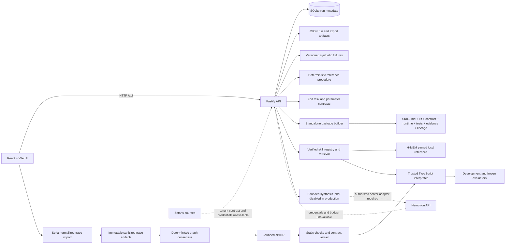

# Ember Forge architecture

The current product is a local, fixture-mode vertical slice. The diagram separates implemented paths from planned live-provider paths.

## Implemented boundaries

- The UI sends typed task parameters to Fastify. The local task endpoint reads only the synthetic fixture and records the result in SQLite plus a JSON artifact.
- A separate import path accepts strict normalized operation traces, excludes raw logs/rows from compiler input, and preserves trace identity. A deterministic adapter assembles agreeing successful graphs and retains counterexamples as lineage; the independent development evaluator is outside the adapter context. This is a replay baseline, not model-driven learning. Generated candidates are stored under artifacts/candidates and selectable in the header.
- The runtime interprets bounded declarative instructions. Candidate validity and input applicability are decided by deterministic checks; H-MEM retrieval nominates records but does not authorize execution.
- The exporter includes the runtime and a network guard, then verifies supported execution and an explicit rejection with model calls disabled.
- A bounded synthesis/repair controller, typed Nemotron adapter, persisted jobs, polling and cancellation exist. Production has no provider adapter under the $0 authorization. Live generation remains unverified. A Zetaris tenant transport contract and bounded page/snapshot orchestration exist; a verified live HTTP/auth implementation is still absent.
- Raw local snapshots live separately from compiler context and can replay normalized tool observations. New candidates retain an independent development split and matching package example. Frozen evaluation generates a later split and preserves the first outcome per candidate hash.
- Library registration repeats verification. H-MEM nominates verified records; stored artifact hashes and deterministic applicability are checked before bounded execution. Policy/schema drift deprecates the incompatible entry, with no automatic model fallback.

## Principal packages

The new original-agent path and evidence boundaries are described in [agent workflow](agent-workflow.md). It chooses trusted tools incrementally rather than replaying a supplied graph. Its model/evaluation/host behavior remains unverified; four-arm measurement and transfer preparation are separate from historical runtime results.

- `apps/web`: workbench, candidate selection, verification/export, frozen evaluation and Skill Library.
- `apps/api`: Fastify, SQLite history, trace snapshots, cancellable synthesis jobs, evaluation, library and tenant transport contract.
- `packages/contracts`: Zod schemas for task, trace, program, skill, and export data.
- `packages/compiler`: verification, consensus baseline, bounded synthesis/repair controller, typed provider adapter and snapshot replay.
- `packages/runtime`: trusted interpreter and standalone entrypoint.
- `packages/memory`: H-MEM adapter and skill registry.
- `packages/evaluator`: deterministic stock-reconciliation oracle.
- `evaluation/frozen-v1`: separated synthetic input/label split and evaluator report.
- `vendor/meterless/hmem`: pinned upstream reference, attribution, instructions, and conformance suite.
