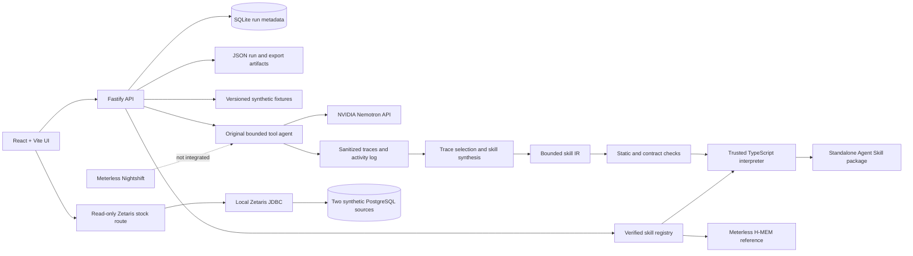

# Ember Forge architecture

The current product is a local prototype with separate fixture-agent and local-Zetaris paths. Model, memory, host, and source evidence is synthetic and bounded; the diagram keeps those paths distinct.

## Implemented boundaries

- The React workbench calls the Fastify API. Local task runs use typed synthetic fixtures and persist SQLite history plus JSON evidence artifacts.
- A bounded original agent chooses trusted read-only tools and has produced real Nemotron trajectories over synthetic fixtures. Raw model reasoning and credentials are not recorded.
- Successful and failed traces can feed bounded skill synthesis. Candidates use a declarative instruction format interpreted by trusted code, with static checks, explicit contracts, independent development cases, and a frozen synthetic evaluation protocol.
- The standalone exporter includes `SKILL.md`, contracts, examples, the bounded runtime, and verification evidence. Supported package inputs run without a model API call; unsupported inputs return structured reasons.
- The local Skill Library uses the pinned Meterless H-MEM reference for verified registration, retrieval, bounded execution, and policy/schema invalidation. Deterministic hash and applicability checks authorize execution; H-MEM only nominates a candidate.
- A separate workbench route performs actual read-only stock reads, a cross-source join, and a controlled freshness check through the local Zetaris JDBC service. It used two synthetic PostgreSQL databases. This path is not yet the source backend of the original Nemotron stock agent or the exported skill.
- Codex and Claude Code explicitly executed an earlier package; Hermes and OpenClaw automatically selected and executed the same newer package on one supported synthetic case each. OpenClaw also refused an unknown unit, though its wrapper changed native exit code 2 to 1.
- Meterless Nightshift is not integrated. The current Nemotron adapter calls NVIDIA directly. Cloud/SaaS Zetaris transport, real business data, production deployment, general workflow learning, broad host-selection accuracy, and savings remain unverified.

## Principal packages

- `apps/web`: Workbench, verification/export, evaluation, Zetaris read action, and Skill Library.
- `apps/api`: Fastify, SQLite history, agent/run orchestration, Zetaris JDBC route, library, and export APIs.
- `packages/contracts`: Zod schemas for task, trace, program, skill, and export data.
- `packages/compiler`: trace processing, bounded synthesis/repair, typed Nemotron adapter, and candidate verification.
- `packages/runtime`: trusted bounded interpreter and standalone package entrypoint.
- `packages/memory`: H-MEM adapter, evidence checks, and verified skill registry.
- `packages/evaluator`: independent deterministic stock-reconciliation oracle.
- `vendor/meterless/hmem`: pinned upstream reference, attribution, and conformance suite.

See [agent workflow](agent-workflow.md), [integration records](integrations.md), [host/source verification](host-and-zetaris-verification.md), and the [hackathon resource audit](hackathon-resource-audit.md) for evidence and remaining sponsor gaps.
