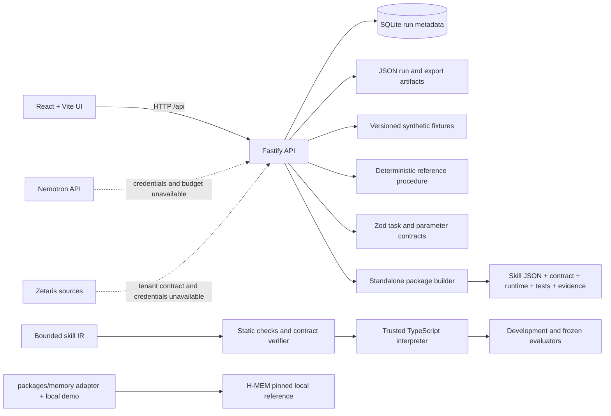

# Pocket Forge architecture

The current product is a local, fixture-mode vertical slice. The diagram separates implemented paths from planned live-provider paths.

## Implemented boundaries

- The UI sends typed task parameters to Fastify. The local task endpoint reads only the synthetic fixture and records the result in SQLite plus a JSON artifact.
- The runtime interprets bounded declarative instructions. Candidate validity and input applicability are decided by deterministic checks; H-MEM retrieval nominates records but does not authorize execution.
- The exporter includes the runtime and a network guard, then verifies supported execution and an explicit rejection with model calls disabled.
- Live Nemotron orchestration and Zetaris connectors are not implemented. Their boxes above show target integrations, not current capabilities.

## Principal packages

- `apps/web`: React/TypeScript five-screen application.
- `apps/api`: Fastify local API and SQLite run history.
- `packages/contracts`: Zod schemas for task, trace, program, skill, and export data.
- `packages/compiler`: bounded candidate and development-suite helpers.
- `packages/runtime`: trusted interpreter and standalone entrypoint.
- `packages/memory`: H-MEM adapter and skill registry.
- `packages/evaluator`: deterministic stock-reconciliation oracle.
- `evaluation/frozen-v1`: separated synthetic input/label split and evaluator report.
- `vendor/meterless/hmem`: pinned upstream reference, attribution, instructions, and conformance suite.
