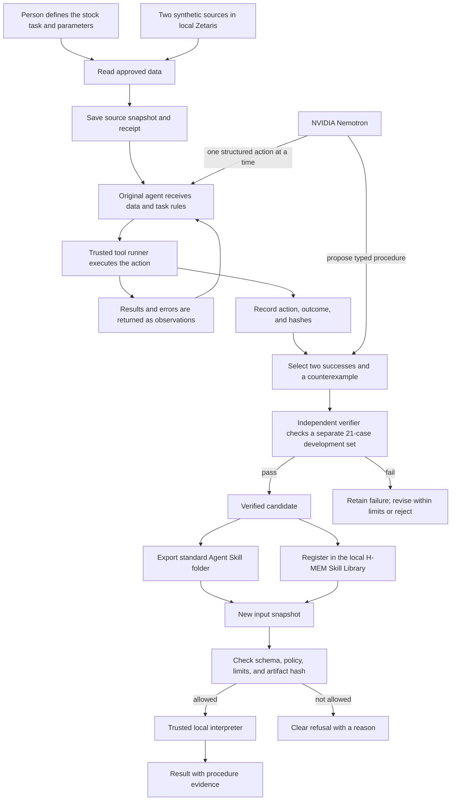

# How Ember Forge works

Ember Forge has two different kinds of run:

1. An **original agent run** uses Nemotron to investigate a task with a fixed set of approved actions. Ember Forge records what it tried and what happened.
2. A **skill run** uses the checked procedure on a new input. For a supported input, the procedure runs locally without model reasoning.

Keeping these two stages separate is the point: use a model to learn and check a repeatable path, then reuse that path when its conditions still hold.

## Full workflow

The live Zetaris call is in the **Read approved data** stage. Its result is saved and linked to a receipt before the original agent uses it. The portable skill consumes the saved snapshot; it does not query Zetaris at runtime.

## What makes the original run an agent

Nemotron does more than answer a single prompt. It receives the task, observed data shape, previous tool results, and the task's fixed rules. It chooses the next action, waits for the real action result, then chooses what to do next. The loop can continue, revise after a failed action, emit a report, or refuse an unsupported case.

Its available actions are deliberately narrow:

- inspect one of the four declared sources;
- read a bounded page of rows;
- run a batch of up to eight declared operations such as filter, lookup, conversion, aggregation, join, and result emission; or
- refuse with a reason code.

Each Nemotron response must match a typed action schema and contain exactly one action. The application executes it. Nemotron cannot provide arbitrary JavaScript, Python, or SQL for the runner to execute. The task runner independently checks the final result; the answer checker does not reveal its reference rows to Nemotron.

The activity record captures action names, result counts, hashes, errors, and timing. It does not save private chain-of-thought or credentials. This gives a reviewer a useful activity trail without presenting hidden reasoning as evidence.

## What Nemotron does in skill creation

Nemotron receives selected successful and failed traces, their declared input fields and schemas, the requested candidate name, and limited verification verdicts. It must return one candidate in the expected JSON shape. The request does not include the independent evaluator implementation, the test answers, or frozen evaluation inputs.

The proposed procedure describes operations and parameters in a restricted JSON format. A trusted TypeScript interpreter runs those operations. The verifier compares results to a separate stock reference and checks the refusal behavior. Only a candidate with a passing verification and a completed package check can be exported.

Generation history remains visible. Three earlier Zetaris-workflow revisions failed with `DUPLICATE_JOIN_KEY`; those failures were retained. The passing candidate was generated after the team corrected the join/filter logic and passed 21 finite development cases. This shows bounded improvement on this task, not a general ability to learn any workflow.

## How the skill is reused

The exported folder includes `SKILL.md`, a typed procedure, the accepted input contract, the runner, supported and unsupported examples, verification results, and provenance. Compatible hosts can discover the folder using the open Agent Skills format. A host may use its own model to decide whether to select a skill; the bundled procedure itself runs without a model request.

Within Ember Forge, Meterless H-MEM helps the Skill Library find a stored candidate for similar work. H-MEM recommends a candidate; Ember Forge then checks the package hash, source schema, policy version, and input limits before execution. A changed schema makes the old entry stale and causes a refusal rather than a guessed result.

## Technology used

| Part | Technology | Job in the product |
| --- | --- | --- |
| Web interface | React 19, TypeScript, Vite 8 | Import work, inspect activity, create and verify skills, and manage the library |
| Local service | Node.js 24, TypeScript, Fastify 5 | Run APIs, original-agent jobs, source reads, checks, and exports |
| Data checks | Zod 4 and an independent stock evaluator | Validate inputs and compare candidate output to a separate expected result |
| Model | NVIDIA Nemotron API | Choose original-agent actions and propose bounded skill candidates |
| Data source | Zetaris JDBC bridge to two local synthetic PostgreSQL sources | Read source tables and create receipt-linked snapshots |
| Memory | Pinned Meterless H-MEM reference | Register and retrieve verified skills inside the Skill Library |
| Run history | Node SQLite and JSON artifacts | Retain jobs, checks, source receipts, and candidate versions |
| Export | JSON instruction format, trusted TypeScript interpreter, Agent Skills folder | Execute a checked procedure on compatible inputs in a separate host |
| Verification | Vitest, independent evaluator, Node package checks | Exercise behavior, refusals, package integrity, and model-free execution |

## Current operating boundary

- The proven workflow is read-only stock reconciliation with whole-number quantities, open orders, caller-supplied alias and unit maps, and zero reserve stock.
- The source examples are synthetic. The two registered databases shared one local PostgreSQL server.
- The live source reads happen during snapshot creation; the exported runner accepts JSON snapshots.
- A supported runner invocation makes no model call. Host selection may still use a model, and the separate original-agent/skill-creation stages do use Nemotron.
- Codex and Claude Code explicitly ran an earlier export. Hermes and OpenClaw automatically selected the same newer Zetaris-origin export once each on a supported synthetic input. This is a small transfer check, not a benchmark of selection accuracy.
- A second fulfilment package exists as a configured template. It does not yet demonstrate learning a second workflow from traces.
- The public Academy FAQ permits direct Nemotron and any cloud. No AWS deployment is needed for the local app demo or offline package run.
