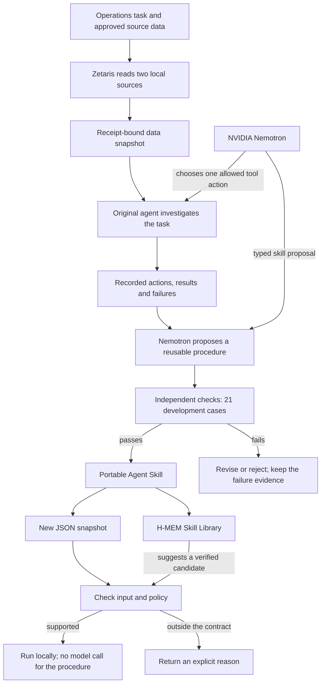

# Ember Forge: make repeated work reusable

## The problem we are solving

An operations planner may need to compare open orders with stock on hand every morning. The answer changes as orders arrive, but the work stays much the same: read the right records, ignore cancelled orders, map supplier product names, convert boxes to individual units, add demand, and report shortages.

An AI agent can do that work, but it may have to rediscover the steps each time. A saved answer goes stale. A saved prompt still asks a model to interpret the instructions again. A person also needs a way to see which inputs the procedure can handle and what it does when data falls outside those rules.

Ember Forge turns examples of repeated agent work into a small, testable procedure that can travel with the task.

## What Ember Forge does

You connect or load approved data, run examples, and inspect what the agent did. Ember Forge saves the tool actions and their results, uses NVIDIA Nemotron to propose a repeatable procedure, checks that procedure against a separate answer checker, and packages the passing version as an installable Agent Skill.

The exported skill includes its instructions, accepted input shape, executable runner, test examples, evidence, and known limits. For a supported input, the runner carries out the procedure without asking a model to reason through those same steps again. When required data or policy is unfamiliar, it returns a clear refusal such as `UNKNOWN_UNIT`.

The current demonstrated task is stock reconciliation. This is a working example of the product idea, not proof that Ember Forge can learn every kind of workflow.

### A few words in everyday language

- A **snapshot** is the saved copy of source data used in a particular run.
- A **trace** is the record of which approved actions ran and what each returned. It does not include private model reasoning.
- A **candidate** is a draft skill being checked before it can be exported.
- A **skill** is the portable folder with instructions, a runner, input rules, examples, and evidence.
- **H-MEM** is the Meterless memory engine Ember Forge uses to find previously verified skills in its local library.

## A worked example

The demo reads synthetic order and warehouse records from two databases registered in local Zetaris. It keeps the source-read receipts with the saved data snapshot, then uses that snapshot for agent runs and skill creation.

For the included example, the skill reports:

| Product | Demand | Stock | Shortage |
| --- | ---: | ---: | ---: |
| CUP-RED | 25 | 15 | 10 |
| MUG-BLUE | 5 | 8 | 0 |

If the same input contains an unapproved unit such as `CRATE`, the skill refuses it with `UNKNOWN_UNIT`. It does not invent a conversion.

## How the work becomes a skill

The live source read happens when the snapshot is made. The portable skill uses that snapshot format; it does not open a Zetaris connection during each later execution. This keeps the judge run simple and makes the example data reviewable.

## Who it is for

- **Operations and planning teams** that repeat the same checks across changing records.
- **Data and automation teams** that need a procedure to be inspectable, testable, and reusable outside one application.
- **Agent builders** who want a portable skill with explicit inputs, evidence, and refusal behavior instead of a prompt that promises more than it can verify.

The current code supports read-only structured data. It is not a general browser agent, an ERP connector, or a no-code workflow builder.

## What makes it different

| Common approach | What it gives you | What Ember Forge adds |
| --- | --- | --- |
| Ask an agent the same question again | Flexible reasoning on every run | A repeatable procedure for inputs already shown to fit |
| Save a prompt or `SKILL.md` instructions | Reusable guidance that a model still interprets | A bundled runner, input rules, checks, examples, and evidence |
| Cache the previous answer | Fast retrieval for the exact same request | Recalculation for new records using the same procedure |
| Write a one-off script | Deterministic results for its author | A workflow built from recorded agent actions, with declared limits and trace links |

Ember Forge still uses a model to investigate and propose a skill. The saved procedure does not use that model for supported execution. In a host such as OpenClaw, the host may spend model tokens deciding whether to select a skill; that selection cost is separate from the skill's own execution.

## Why that could matter

Repeated reasoning can add latency, provider usage, and variation between runs. A checked procedure can make the supported part quicker to repeat and easier for another person to inspect. The H-MEM library can also retrieve a previously verified candidate and refuse it after a schema or policy change.

There is a narrow synthetic comparison in the repository: over three repeats of nine cases, the exact executable passed all 27 invocations with zero model requests. The instruction-only version also passed all 27 and used 33 model requests; the original agent passed 24/27. This is evidence for that small test only. It excludes the cost of compiling a skill, does not establish a dollar saving or break-even point, and uses synthetic data.

## What is built today

- A local web app for work samples, agent runs, activity history, skill creation, checks, export, and the Skill Library.
- A working original Nemotron agent for the stock-reconciliation task. It chooses from a fixed set of read and calculation tools; it cannot submit arbitrary code or SQL.
- A local Zetaris path that read two registered synthetic sources and supplied receipt-bound snapshots to agent runs and skill creation.
- A Nemotron-generated stock skill that passed 21/21 development cases: 7 supported inputs were correct and 14 unsupported inputs were refused.
- A working Meterless H-MEM feature in the Skill Library: product integration tests 7/7, upstream conformance checks 13/13, and a cold/warm reuse demonstration with zero model calls.
- One portable skill with automatic selection evidence in Hermes and OpenClaw. Codex and Claude Code explicitly ran an earlier export. These results do not establish broad automatic-selection accuracy across all hosts.

The [sponsor integration review](sponsor-integration-review.md) explains what was connected, the obstacles, and what we learned. The [run guide and evidence index](run-and-evidence.md) contains reproducible commands and linked proof.

## Limits we state plainly

All tracked examples are synthetic. Two Zetaris databases shared one local PostgreSQL server. The exported skill uses a captured snapshot rather than querying live source systems. The learned workflow covers stock reconciliation; a separate fulfilment package is a configured template, not a second learned task. Real-world accuracy, broad generalization, production readiness, and total savings have not been established. No direct sponsor endorsement or feedback has been received.
